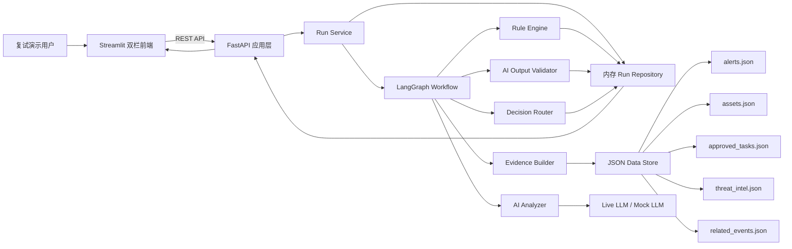
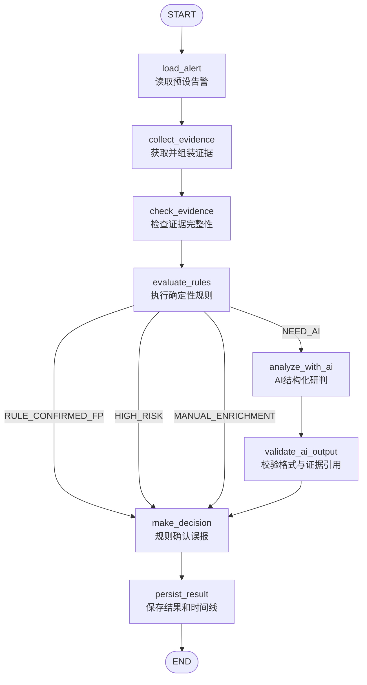
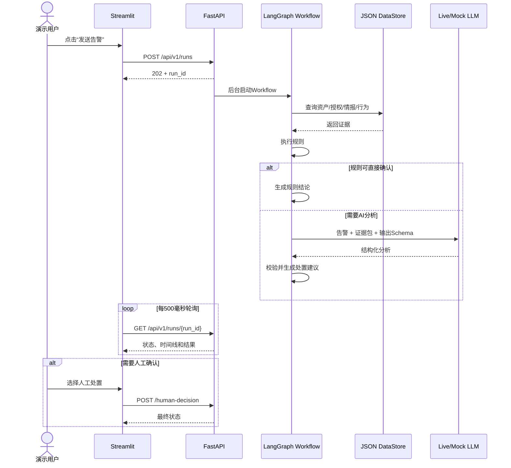

# SOC 告警误报分层研判 Demo 实现方案

## 1. 实现目标

本方案用于指导 **AlertLens——SOC 告警误报分层研判 Demo** 的实际编码。

系统接收用户从页面发送的一条预设告警，通过固定 Workflow 依次完成：

1. 获取告警相关证据；
2. 校验证据完整性；
3. 执行确定性规则；
4. 在规则无法判断时调用 AI；
5. 校验 AI 结构化输出；
6. 生成最终处置建议；
7. 在页面右侧展示完整研判过程；
8. 必要时等待人工确认。

第一版只实现“恶意 IP 通信”告警类型，只使用资产、授权活动、威胁情报和行为上下文四类模拟证据源。

---

## 2. 技术栈

| 层次 | 技术 | 用途 | 选择原因 |
|---|---|---|---|
| 前端 | Streamlit | 左右双栏页面、发送告警、轮询结果、人工确认、一键重置 | 开发快，适合 4 小时 Demo |
| 后端 | FastAPI | REST API、参数校验、后台运行 Workflow | 接口清晰，便于前后端解耦和讲解 |
| Workflow | LangGraph | 固定节点编排、条件路由、共享状态 | 适合展示受约束的 Agent Workflow |
| 数据模型 | Pydantic v2 | 告警、证据、规则结果、AI输出和API模型 | 类型明确，支持自动校验和 JSON Schema |
| AI 接口 | OpenAI-compatible SDK | 调用兼容 OpenAI 接口的大模型 | 易替换模型，可使用结构化输出 |
| Demo 数据 | 本地 JSON | 预设告警及四类证据源 | 可控、稳定、无需外部依赖 |
| 状态存储 | 进程内 Repository | 保存运行状态、时间线和人工操作 | 第一版无需数据库 |
| HTTP 客户端 | httpx | Streamlit 调用 FastAPI | 同步/异步支持完整 |
| 测试 | pytest + FastAPI TestClient | 规则、路由、接口和端到端测试 | 实现简单，便于快速验证 |
| 配置 | pydantic-settings + `.env` | 模型地址、密钥、阈值和运行模式 | 避免硬编码敏感信息 |

### 2.1 建议运行版本

```text
Python              3.11+
streamlit           1.x
fastapi             0.x
uvicorn              0.x
langgraph            1.x
pydantic             2.x
pydantic-settings    2.x
openai               2.x
httpx                0.x
pytest               8.x
```

实际安装时固定已验证版本到 `requirements.txt`，不要在文档中依赖浮动版本号。

### 2.2 运行模式

系统支持两种 AI 模式：

- `AI_MODE=live`：真实调用大模型；
- `AI_MODE=mock`：根据案例编号返回预设结构化结果，确保现场演示稳定。

除 AI 节点外，两种模式使用完全相同的证据、规则、校验和决策流程。

---

## 3. 总体架构



## 3.1 架构边界

### Streamlit 前端

只负责：

- 展示预设告警；
- 发送告警；
- 轮询运行状态；
- 展示时间线、证据、规则或 AI 结果；
- 提交人工决定；
- 重置 Demo。

前端不包含规则和处置逻辑。

### FastAPI 应用层

负责：

- 暴露 REST API；
- 校验请求和响应；
- 创建后台研判任务；
- 查询运行状态；
- 接收人工处置；
- 执行重置。

### LangGraph Workflow

负责节点执行顺序和条件路由。它不是开放式 ReAct Agent，不允许模型自由选择工具或修改流程。

### 领域服务

- `EvidenceBuilder`：组装证据包；
- `RuleEngine`：执行确定性规则；
- `AIAnalyzer`：调用真实或 Mock 模型；
- `AIValidator`：校验 AI 输出；
- `DecisionRouter`：生成最终处置结果。

### Repository

以线程安全的内存字典保存每次运行。进程重启或一键重置后数据恢复到初始状态。

---

## 4. 目录结构

```text
soc/
├─ README.md
├─ requirements.txt
├─ .env.example
├─ run_demo.ps1
├─ app.py                         # Streamlit 入口
├─ backend/
│  ├─ __init__.py
│  ├─ main.py                     # FastAPI 入口
│  ├─ config.py                   # 环境变量和阈值
│  ├─ api/
│  │  ├─ alerts.py                # 预设告警接口
│  │  ├─ runs.py                  # 研判运行接口
│  │  └─ demo.py                  # 重置和健康检查
│  ├─ models/
│  │  ├─ alert.py
│  │  ├─ evidence.py
│  │  ├─ rule.py
│  │  ├─ ai_result.py
│  │  ├─ run.py
│  │  └─ api.py
│  ├─ workflow/
│  │  ├─ graph.py                 # LangGraph 构图
│  │  ├─ state.py                 # Workflow State
│  │  ├─ nodes.py                 # 节点函数
│  │  └─ routes.py                # 条件路由函数
│  ├─ services/
│  │  ├─ data_store.py
│  │  ├─ evidence_builder.py
│  │  ├─ rule_engine.py
│  │  ├─ ai_analyzer.py
│  │  ├─ ai_validator.py
│  │  └─ decision_router.py
│  ├─ repositories/
│  │  └─ run_repository.py
│  └─ prompts/
│     └─ alert_analysis.txt
├─ data/
│  ├─ alerts.json
│  ├─ assets.json
│  ├─ approved_tasks.json
│  ├─ threat_intel.json
│  └─ related_events.json
└─ tests/
   ├─ test_evidence_builder.py
   ├─ test_rule_engine.py
   ├─ test_decision_router.py
   ├─ test_workflow.py
   └─ test_api.py
```

第一版如果时间紧张，可以将 `backend/api` 中的多个路由文件合并到 `main.py`，但领域服务和 Workflow 仍保持分离。

---

## 5. 核心数据模型

## 5.1 告警模型

```python
class Alert(BaseModel):
    alert_id: str
    alert_time: datetime
    alert_type: Literal["malicious_ip_connection"]
    alert_name: str
    severity: Literal["low", "medium", "high", "critical"]
    source: str
    src_ip: IPvAnyAddress
    src_port: int | None = None
    dst_ip: IPvAnyAddress
    dst_port: int | None = None
    protocol: str | None = None
    host_id: str
    hostname: str
    user: str
    process: ProcessInfo | None = None
    detection: DetectionInfo
    demo_scenario: str
```

`demo_scenario` 仅用于左侧帮助演示者选择案例，不传给规则和 AI，避免泄露预设答案。

## 5.2 统一证据模型

```python
class EvidenceItem(BaseModel):
    evidence_id: str
    evidence_type: Literal[
        "asset_context",
        "approved_activity",
        "threat_intelligence",
        "behavior_context",
    ]
    source: str
    observed_at: datetime
    content: dict[str, Any]


class EvidencePackage(BaseModel):
    alert_id: str
    items: list[EvidenceItem]
    missing_evidence: list[str] = []
    retrieval_errors: list[str] = []
```

## 5.3 规则结果模型

```python
class MatchedRule(BaseModel):
    rule_id: str
    rule_name: str
    reason: str
    evidence_refs: list[str]


class RuleResult(BaseModel):
    decision: Literal[
        "HIGH_RISK",
        "RULE_CONFIRMED_FP",
        "MANUAL_ENRICHMENT",
        "NEED_AI",
    ]
    matched_rule: MatchedRule
    need_ai: bool
    need_human: bool
```

## 5.4 AI 结果模型

```python
class ConfidenceBreakdown(BaseModel):
    evidence_completeness: int = Field(ge=0, le=25)
    support_strength: int = Field(ge=0, le=25)
    evidence_consistency: int = Field(ge=0, le=25)
    conclusion_clarity: int = Field(ge=0, le=25)
    total: int = Field(ge=0, le=100)
    reason: str


class EvidenceReason(BaseModel):
    evidence_id: str
    reason: str


class AIAnalysisResult(BaseModel):
    suggested_result: Literal[
        "likely_false_positive",
        "likely_true_positive",
        "insufficient_evidence",
    ]
    confidence: ConfidenceBreakdown
    supporting_evidence: list[EvidenceReason]
    contradicting_evidence: list[EvidenceReason]
    missing_evidence: list[str]
    recommended_action: str
    summary: str
```

## 5.5 Workflow 状态模型

LangGraph State 使用 `TypedDict`，节点输出只更新自己负责的字段：

```python
class WorkflowState(TypedDict, total=False):
    run_id: str
    alert_id: str
    alert: Alert
    status: str

    evidence_package: EvidencePackage
    evidence_complete: bool

    rule_result: RuleResult
    high_risk_veto: bool

    ai_result: AIAnalysisResult
    ai_validation_errors: list[str]

    final_action: str
    need_human: bool
    final_reason: str

    timeline: Annotated[list[TimelineEvent], operator.add]
    errors: Annotated[list[str], operator.add]
```

## 5.6 运行记录模型

```python
class RunRecord(BaseModel):
    run_id: str
    alert_id: str
    status: Literal[
        "queued",
        "collecting_evidence",
        "rule_analyzing",
        "ai_analyzing",
        "waiting_human",
        "completed",
        "failed",
    ]
    analysis_mode: Literal["rule", "ai", "manual"] | None
    state: dict[str, Any]
    created_at: datetime
    updated_at: datetime
```

---

## 6. 数据获取与证据组装

## 6.1 DataStore 接口

```python
class JsonDataStore:
    def list_alerts(self) -> list[Alert]: ...

    def get_alert(self, alert_id: str) -> Alert | None: ...

    def find_asset(self, host_id: str) -> dict | None: ...

    def find_approved_task(
        self,
        user: str,
        host_id: str,
        event_time: datetime,
        target_ip: str,
    ) -> dict | None: ...

    def find_threat_intel(self, indicator: str) -> dict | None: ...

    def find_related_events(
        self,
        alert_id: str,
        host_id: str,
        center_time: datetime,
        window_minutes: int = 30,
    ) -> dict | None: ...
```

应用启动时一次性读取并校验 JSON。若数据文件格式错误，后端启动失败并显示具体文件与字段，不在研判过程中静默忽略。

## 6.2 关联键

| 证据源 | 主关联键 | 附加判断 |
|---|---|---|
| 资产 | `alert.host_id` | 无 |
| 授权任务 | `user + host_id` | 告警时间是否在窗口内、目标IP是否在授权网段 |
| 威胁情报 | `alert.dst_ip` | 情报是否过期 |
| 行为上下文 | `alert_id` | 找不到时使用 `host_id + 前后30分钟` |

## 6.3 EvidenceBuilder 接口

```python
class EvidenceBuilder:
    def __init__(self, data_store: JsonDataStore): ...

    def build(self, alert: Alert) -> EvidencePackage: ...
```

证据编号按固定顺序生成，便于演示和测试：

```text
EV-001：资产上下文
EV-002：授权活动
EV-003：威胁情报
EV-004：行为上下文
```

未查询到某类证据时，不创建空的 `EvidenceItem`，而是在 `missing_evidence` 中记录，例如 `asset_context_not_found`。

---

## 7. 规则引擎实现

## 7.1 执行优先级

```text
1. 高风险否决规则 R-001～R-005
2. 数据质量规则   R-201～R-202
3. 明确误报规则   R-101～R-102
4. AI入口规则      R-301～R-399
```

高风险规则必须最先执行，避免授权任务或白名单覆盖真实攻击迹象。

## 7.2 第一版必须实现的规则

| ID | 条件 | 结果 |
|---|---|---|
| R-001 | `lateral_movement == true` | `HIGH_RISK` |
| R-003 | `data_exfiltration == true` | `HIGH_RISK` |
| R-005 | 核心资产且目标命中恶意情报 | `HIGH_RISK` |
| R-101 | 测试/扫描资产 + 有效授权 + 时间和目标均在范围内 + 无高风险行为 | `RULE_CONFIRMED_FP` |
| R-201 | `host_id`、`alert_time`、`dst_ip` 任一缺失 | `MANUAL_ENRICHMENT` |
| R-301 | 无有效授权且目标命中恶意情报 | `NEED_AI` |
| R-302 | 有授权但同时存在恶意情报或行为冲突 | `NEED_AI` |
| R-399 | 未命中其他终止规则 | `NEED_AI` |

## 7.3 RuleEngine 接口

```python
class RuleEngine:
    def evaluate(
        self,
        alert: Alert,
        evidence: EvidencePackage,
    ) -> RuleResult: ...
```

规则定义采用普通 Python 函数，不引入复杂规则引擎依赖。规则数量少，直接编码更容易测试和解释。

---

## 8. Agent Workflow 设计

## 8.1 工作流图



## 8.2 节点职责

### 节点1：`load_alert`

输入：`alert_id`。

工作：

- 从 `alerts.json` 获取告警；
- 未找到时记录错误并终止；
- 将状态更新为 `collecting_evidence`；
- 写入时间线。

### 节点2：`collect_evidence`

工作：

- 调用 `EvidenceBuilder.build()`；
- 查询四个数据源；
- 生成统一证据编号；
- 记录缺失证据和查询错误。

### 节点3：`check_evidence`

工作：

- 检查规则和 AI 最低所需字段；
- 计算 `evidence_complete`；
- 不直接终止流程，交由规则节点决定是否允许 AI 分析。

### 节点4：`evaluate_rules`

工作：

- 按优先级执行规则；
- 保存命中规则和引用证据；
- 设置 `high_risk_veto`；
- 通过条件边决定结束或进入 AI。

### 节点5：`analyze_with_ai`

只在 `RuleResult.decision == NEED_AI` 时运行。

工作：

- 将证据包序列化为模型输入；
- 使用固定 System Prompt；
- 要求返回 `AIAnalysisResult`；
- `live` 模式调用模型，`mock` 模式读取预设返回；
- 将状态改为 `ai_analyzing`。

### 节点6：`validate_ai_output`

工作：

- 验证 Pydantic 模型；
- 验证四项置信度之和等于 `total`；
- 验证所有 `evidence_id` 存在；
- 验证引用内容没有超出输入证据；
- 校验失败时记录错误，后续转人工。

### 节点7：`make_decision`

工作：

- 规则明确误报：确认误报；
- 高风险规则：高优先级人工调查；
- 数据不足：等待人工补充；
- AI 疑似误报且置信度不低于 85：确认误报；
- AI 疑似误报但置信度不足：等待人工确认；
- AI 疑似真实攻击：高优先级人工调查；
- AI 输出无效：等待人工确认。

### 节点8：`persist_result`

工作：

- 保存最终状态；
- 将运行状态置为 `waiting_human`、`completed` 或 `failed`；
- 写入最后一条时间线事件。

## 8.3 条件路由函数

```python
def route_after_rules(state: WorkflowState) -> str:
    decision = state["rule_result"].decision
    if decision == "NEED_AI":
        return "analyze_with_ai"
    return "make_decision"
```

## 8.4 Workflow 构建伪代码

```python
builder = StateGraph(WorkflowState)

builder.add_node("load_alert", load_alert)
builder.add_node("collect_evidence", collect_evidence)
builder.add_node("check_evidence", check_evidence)
builder.add_node("evaluate_rules", evaluate_rules)
builder.add_node("analyze_with_ai", analyze_with_ai)
builder.add_node("validate_ai_output", validate_ai_output)
builder.add_node("make_decision", make_decision)
builder.add_node("persist_result", persist_result)

builder.add_edge(START, "load_alert")
builder.add_edge("load_alert", "collect_evidence")
builder.add_edge("collect_evidence", "check_evidence")
builder.add_edge("check_evidence", "evaluate_rules")
builder.add_conditional_edges(
    "evaluate_rules",
    route_after_rules,
    {
        "analyze_with_ai": "analyze_with_ai",
        "make_decision": "make_decision",
    },
)
builder.add_edge("analyze_with_ai", "validate_ai_output")
builder.add_edge("validate_ai_output", "make_decision")
builder.add_edge("make_decision", "persist_result")
builder.add_edge("persist_result", END)

workflow = builder.compile()
```

## 8.5 为什么采用固定 Workflow

- 安全处置流程必须可控；
- 规则和 AI 的职责边界清楚；
- 每次执行路径可复现；
- 高风险规则无法被模型跳过；
- 更容易向面试官解释 Agent 的节点、状态和路由；
- 便于针对每条分支编写测试。

---

## 9. AI 节点实现

## 9.1 输入构造

只向模型传入：

- 告警必要字段；
- 标准化证据包；
- 缺失证据；
- 输出 Schema；
- 研判约束。

不传 `demo_scenario`、预设标签或最终期望结果。

## 9.2 System Prompt 约束

```text
你是SOC告警研判助手。
你只能依据输入的告警和证据进行分析，不得补充不存在的事实。
每项判断必须引用真实存在的evidence_id。

输出必须包含：
1. 建议结论；
2. 四项置信度及总分；
3. 支持当前结论的证据；
4. 与当前结论冲突的证据；
5. 缺失证据；
6. 下一步建议；
7. 简明总结。

你不能调用工具，不能修改告警状态，不能决定是否关闭告警。
证据不足时输出insufficient_evidence。
```

## 9.3 AIAnalyzer 接口

```python
class AIAnalyzer(Protocol):
    def analyze(
        self,
        alert: Alert,
        evidence: EvidencePackage,
    ) -> AIAnalysisResult: ...


class LiveAIAnalyzer(AIAnalyzer): ...
class MockAIAnalyzer(AIAnalyzer): ...
```

## 9.4 置信度校验

```python
def validate_confidence(result: AIAnalysisResult) -> list[str]:
    c = result.confidence
    calculated = (
        c.evidence_completeness
        + c.support_strength
        + c.evidence_consistency
        + c.conclusion_clarity
    )
    return [] if calculated == c.total else ["confidence_total_mismatch"]
```

AI 置信度为 Demo 启发式参考分，不是经过真实样本校准的概率。页面固定展示该说明。

## 9.5 超时与回退

- 模型调用超时：10～15 秒；
- 第一次失败允许重试一次；
- 第二次失败后不自动切换 Mock 结论，避免把模拟结果伪装成真实 AI；
- 返回 `AI_UNAVAILABLE`，转人工确认；
- 演示前可主动切换 `AI_MODE=mock` 保证稳定。

---

## 10. 处置决策

```python
def decide(state: WorkflowState, threshold: int = 85) -> DecisionResult:
    rule = state["rule_result"]

    if rule.decision == "RULE_CONFIRMED_FP":
        return DecisionResult(
            action="confirm_false_positive_by_rule",
            need_human=False,
        )

    if rule.decision == "HIGH_RISK" or state.get("high_risk_veto"):
        return DecisionResult(
            action="high_priority_manual_investigation",
            need_human=True,
        )

    if rule.decision == "MANUAL_ENRICHMENT":
        return DecisionResult(
            action="manual_enrichment",
            need_human=True,
        )

    if state.get("ai_validation_errors"):
        return DecisionResult(
            action="manual_review",
            need_human=True,
        )

    ai = state["ai_result"]
    if ai.suggested_result == "insufficient_evidence":
        return DecisionResult(action="manual_review", need_human=True)

    if ai.suggested_result == "likely_true_positive":
        return DecisionResult(
            action="high_priority_manual_investigation",
            need_human=True,
        )

    if ai.confidence.total >= threshold:
        return DecisionResult(
            action="confirm_false_positive_by_ai",
            need_human=False,
        )

    return DecisionResult(action="manual_review", need_human=True)
```

---

## 11. REST API 设计

统一前缀：`/api/v1`。

## 11.1 获取预设告警

```http
GET /api/v1/alerts
```

响应：

```json
{
  "items": [
    {
      "alert_id": "ALT-001",
      "alert_name": "终端访问恶意IP",
      "severity": "high",
      "source": "EDR",
      "hostname": "DEV-PC-025",
      "dst_ip": "203.0.113.25",
      "demo_scenario": "授权扫描",
      "status": "ready"
    }
  ]
}
```

## 11.2 创建研判运行

```http
POST /api/v1/runs
Content-Type: application/json

{
  "alert_id": "ALT-001"
}
```

后端创建后台任务并立即返回：

```json
{
  "run_id": "RUN-6f7a...",
  "alert_id": "ALT-001",
  "status": "queued",
  "poll_url": "/api/v1/runs/RUN-6f7a..."
}
```

状态码：`202 Accepted`。

约束：同一 `alert_id` 存在未完成运行时返回 `409 Conflict`，防止重复点击。

## 11.3 查询运行结果

```http
GET /api/v1/runs/{run_id}
```

处理中响应：

```json
{
  "run_id": "RUN-6f7a...",
  "status": "ai_analyzing",
  "analysis_mode": "ai",
  "timeline": [
    {
      "node": "collect_evidence",
      "status": "completed",
      "message": "已获取4类证据",
      "timestamp": "2026-11-18T17:10:01+08:00"
    },
    {
      "node": "evaluate_rules",
      "status": "completed",
      "message": "命中R-302，进入AI研判",
      "timestamp": "2026-11-18T17:10:02+08:00"
    }
  ]
}
```

完成后响应增加：

```json
{
  "status": "waiting_human",
  "analysis_mode": "ai",
  "rule_result": {},
  "evidence_package": {},
  "ai_result": {
    "suggested_result": "likely_false_positive",
    "confidence": {
      "total": 72
    }
  },
  "decision": {
    "action": "manual_review",
    "need_human": true,
    "reason": "AI置信度未达到85，且存在证据冲突"
  },
  "timeline": []
}
```

## 11.4 提交人工决定

```http
POST /api/v1/runs/{run_id}/human-decision
Content-Type: application/json

{
  "decision": "confirm_false_positive",
  "comment": "已核对扫描任务编号TASK-008"
}
```

`decision` 可选值：

- `confirm_false_positive`；
- `confirm_true_positive`；
- `continue_investigation`。

只有 `status == waiting_human` 的运行允许提交，否则返回 `409 Conflict`。

## 11.5 重置 Demo

```http
POST /api/v1/demo/reset
```

响应：

```json
{
  "success": true,
  "message": "Demo状态已恢复",
  "alerts_reset": 10,
  "runs_removed": 6
}
```

重置只清空内存状态，不修改 `data/*.json`。

## 11.6 健康检查

```http
GET /api/v1/health
```

```json
{
  "status": "ok",
  "ai_mode": "mock",
  "data_loaded": true,
  "alert_count": 10
}
```

## 11.7 通用错误格式

```json
{
  "error": {
    "code": "ALERT_NOT_FOUND",
    "message": "未找到告警 ALT-999",
    "details": {}
  }
}
```

---

## 12. 前后端交互时序



---

## 13. 前端实现

## 13.1 页面结构

```python
st.set_page_config(layout="wide", page_title="AlertLens")

header = st.container()
left, right = st.columns([0.42, 0.58], gap="large")

with header:
    render_title_and_reset()

with left:
    render_alert_cards()

with right:
    render_run_result()
```

## 13.2 左侧告警卡片

每张卡片包括：

- 严重程度颜色；
- 告警名称；
- 主机和目标 IP；
- 场景标签；
- 当前状态；
- “发送告警”按钮。

发送后将 `run_id` 保存到 `st.session_state`：

```python
if st.button("发送告警", key=f"send_{alert.alert_id}"):
    run = api.create_run(alert.alert_id)
    st.session_state.current_run_id = run["run_id"]
    st.session_state.selected_alert_id = alert.alert_id
    st.rerun()
```

## 13.3 右侧结果区

根据 `status` 渲染：

| 状态 | 页面表现 |
|---|---|
| 未选择 | 提示“请从左侧发送一条告警” |
| `queued` | 显示排队中 |
| `collecting_evidence` | 显示证据获取进度 |
| `rule_analyzing` | 显示规则研判中 |
| `ai_analyzing` | 显示 AI 研判中 |
| `waiting_human` | 展示完整结果和人工按钮 |
| `completed` | 展示最终结论 |
| `failed` | 展示错误和建议 |

结果区使用 Tabs 或 Expander：

```text
[结论摘要] [Workflow轨迹] [证据包] [规则结果] [AI分析]
```

规则路径的 AI 分析页显示“本次由规则直接完成，未调用 AI”。

## 13.4 轮询

前端每 500～800 毫秒查询一次运行状态，运行完成后停止轮询。单次 Demo 同时只允许一个活动运行。

若 Streamlit 自动刷新实现不稳定，可退化为同步等待并在完成后一次性展示时间线，不影响核心研判能力。

## 13.5 一键重置

```python
if st.button("一键刷新/重置", type="secondary"):
    api.reset_demo()
    st.session_state.clear()
    st.rerun()
```

---

## 14. 后台运行与状态管理

## 14.1 创建运行

FastAPI 接收请求后：

1. 检查告警是否存在；
2. 检查是否已有同告警的活动运行；
3. 创建 `RunRecord(status="queued")`；
4. 将 Workflow 放入 `BackgroundTasks`；
5. 返回 `202 + run_id`。

## 14.2 Repository 接口

```python
class RunRepository:
    def create(self, record: RunRecord) -> None: ...
    def get(self, run_id: str) -> RunRecord | None: ...
    def update(self, run_id: str, **changes) -> RunRecord: ...
    def find_active_by_alert(self, alert_id: str) -> RunRecord | None: ...
    def clear(self) -> int: ...
```

使用 `threading.RLock` 保护内存字典，避免轮询和后台 Workflow 同时读写造成状态不一致。

## 14.3 时间线记录

每个节点至少记录开始和完成事件：

```json
{
  "node": "evaluate_rules",
  "status": "completed",
  "message": "命中R-302：证据冲突，进入AI研判",
  "timestamp": "2026-11-18T17:10:02+08:00",
  "duration_ms": 4
}
```

为了让演示过程可见，Mock 模式可在节点间增加 200～400 毫秒的可配置演示延迟；测试环境将延迟设为 0。

---

## 15. 配置设计

`.env.example`：

```dotenv
APP_ENV=demo
API_BASE_URL=http://127.0.0.1:8000/api/v1

AI_MODE=mock
OPENAI_API_KEY=
OPENAI_BASE_URL=
OPENAI_MODEL=
AI_TIMEOUT_SECONDS=15
AI_MAX_RETRIES=1

AI_FALSE_POSITIVE_THRESHOLD=85
DEMO_NODE_DELAY_MS=300
DATA_DIR=./data
```

配置校验：

- `AI_MODE=live` 时必须提供模型名称和密钥；
- 阈值必须在 0～100；
- `DATA_DIR` 必须存在；
- 生产密钥不能写入仓库。

---

## 16. 异常处理

| 异常 | 处理方式 | 最终状态 |
|---|---|---|
| 告警不存在 | API 返回 404 | 不创建运行 |
| JSON 数据损坏 | 后端启动失败，指出文件和字段 | 服务不可用 |
| 某类证据未查到 | 记录 `missing_evidence` | 规则决定转人工或 AI |
| AI 超时 | 重试一次，仍失败则转人工 | `waiting_human` |
| AI JSON 非法 | 记录校验错误 | `waiting_human` |
| AI 引用不存在的证据 | 判为输出无效 | `waiting_human` |
| Workflow 节点异常 | 捕获异常并写入时间线 | `failed` |
| 重复发送同一告警 | API 返回 409 | 保留原运行 |
| 人工操作状态不合法 | API 返回 409 | 状态不变 |

---

## 17. 测试方案

## 17.1 单元测试

### 证据构建

- 能按 `host_id` 获取资产；
- 能正确判断授权时间和目标范围；
- 找不到证据时记录缺失项；
- 不把 `demo_scenario` 写入证据包。

### 规则引擎

- 横向移动优先于授权扫描规则；
- 数据外传优先于白名单规则；
- R-101 必须同时满足所有条件；
- 证据冲突进入 AI；
- 默认路径进入 AI。

### AI 校验

- 四项置信度总和错误时拒绝；
- 引用不存在的证据时拒绝；
- 枚举值非法时拒绝；
- 合法结果通过。

### 决策路由

- 规则确认误报无需人工；
- 高风险始终需要人工；
- AI 疑似误报且置信度 85 时确认误报；
- AI 疑似误报且置信度 84 时人工确认；
- AI 证据不足时人工确认；
- AI 疑似真实攻击时高优先级调查。

## 17.2 Workflow 测试案例

至少覆盖：

1. R-101 规则直接确认误报；
2. R-001 高风险否决；
3. R-302 进入 AI 后高置信度确认误报；
4. R-302 进入 AI 后低置信度转人工；
5. AI 输出引用非法证据后转人工；
6. AI 服务不可用后转人工；
7. 关键字段缺失后人工补充。

## 17.3 API 测试

- 获取告警列表返回 200；
- 创建运行返回 202；
- 不存在告警返回 404；
- 重复运行返回 409；
- 查询运行返回当前时间线；
- 非等待人工状态不能提交人工结果；
- 重置后运行记录为空、告警状态恢复。

---

## 18. 实现顺序

### 阶段1：模型与数据

- 创建 Pydantic 模型；
- 创建 8～10 条告警；
- 创建四类证据 JSON；
- 实现并测试 `JsonDataStore`；
- 实现 `EvidenceBuilder`。

验收：任意告警都能生成证据包，并明确列出缺失证据。

### 阶段2：规则与决策

- 实现规则优先级；
- 实现第一版规则；
- 实现 `DecisionRouter`；
- 编写边界测试。

验收：无需 AI 即可跑通规则确认、高风险和数据缺失三条路径。

### 阶段3：AI 与 Workflow

- 实现 Mock AI；
- 实现 Live AI 接口；
- 实现 AI 输出校验；
- 构建 LangGraph；
- 保存 Workflow 时间线。

验收：规则转 AI 后可以分别进入自动确认、人工确认和高优先级调查。

### 阶段4：API

- 实现 Run Repository；
- 实现创建、查询、人工确认、重置和健康接口；
- 使用 TestClient 验证接口。

验收：能够仅通过 API 完成一条告警的完整流程。

### 阶段5：Streamlit 页面

- 实现左右双栏；
- 实现告警卡片；
- 实现发送与轮询；
- 实现结果、时间线和证据展示；
- 实现人工按钮和一键重置。

验收：可以连续演示四种代表案例并一键恢复。

---

## 19. 本地运行方式

`run_demo.ps1` 分别启动后端和前端：

```powershell
$env:PYTHONPATH = (Get-Location).Path
Start-Process python -ArgumentList '-m', 'uvicorn', 'backend.main:app', '--host', '127.0.0.1', '--port', '8000' -WindowStyle Hidden
python -m streamlit run app.py --server.port 8501
```

README 中同时提供手动启动方式：

```powershell
python -m uvicorn backend.main:app --host 127.0.0.1 --port 8000
python -m streamlit run app.py --server.port 8501
```

演示地址：`http://127.0.0.1:8501`。

---

## 20. 复试时的技术说明重点

1. 本项目不是让大模型自由决策，而是使用 LangGraph 构建固定、可审计的 Workflow；
2. 规则、高风险否决和 AI 分析具有明确优先级；
3. 证据包由四类本地数据按真实关联键动态组装，不是直接把预设答案交给 AI；
4. AI 只能输出结构化建议，不能直接调用处置工具；
5. AI 输出必须通过 Schema、置信度和证据引用校验；
6. 页面能够解释本次使用规则研判还是 AI 研判，以及为什么需要人工；
7. Mock 模式只用于保证演示稳定，和 Live 模式共用同一条业务链路；
8. 真实落地时，可以把 JSON DataStore 替换为 CMDB、工单、威胁情报和 EDR/SIEM 接口，而无需修改 Workflow 主体。

---

## 21. 第一版完成标准

- 后端可以加载 8～10 条告警和四类证据；
- 点击发送告警后能够创建独立 `run_id`；
- Workflow 至少包含证据获取、证据检查、规则研判、AI研判、AI校验、处置决策和结果保存节点；
- 高风险规则的优先级高于误报规则；
- 规则路径不会调用 AI；
- AI 路径能够显示建议结论、四项置信度、证据引用和建议；
- AI 输出非法时能够安全转人工；
- 页面右侧明确显示研判方式和是否需要人工；
- 人工可以提交三种处置结果；
- 一键重置后所有告警恢复待发送状态；
- 核心规则、决策路由、Workflow 和 API 测试通过；
- README 能让面试官在本地完成启动。
